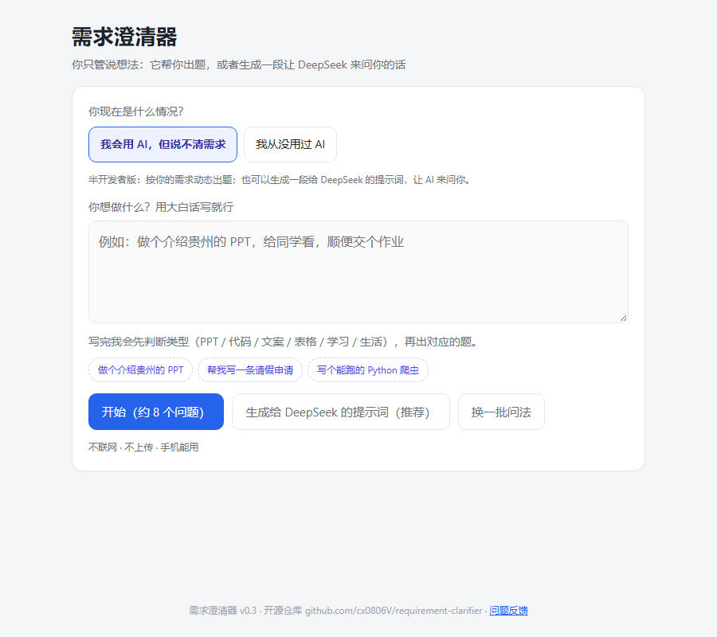

# 需求澄清器

> **说清想法，就能让 AI 干活。** 你写一句大白话 → 它按你的需求类型出题（或生成一段让 DeepSeek 来问你的话）→ 拿到一份能直接粘给 AI、也能验收的需求。



## 三种用法（v0.3）

| 用法 | 适合谁 | 怎么用 |
|---|---|---|
| **自己答题** | 会用 AI、但说不清需求 | 写一句需求 → 它按类型动态出 5–8 题（每题有现成答案）→ 生成需求提示词 |
| **让 DeepSeek 来问** | 想让 AI 多问几轮 | 生成一段提示词 → 粘到 DeepSeek / 豆包网页版 → 答完把它输出的「需求总结」贴回来 → 生成最终需求 |
| **零基础 5 题** | 从没用过 AI | 只问 5 题、每题都有现成答案，最后给你一段话 |

选过的模式会被记住（只存在你自己的浏览器里）。

## 功能（v0.3）

- **动态出题**：先判断你的需求类型（PPT / 代码 / 文案 / 表格 / 学习 / 生活 / 通用），再从题库组装对应的问题——不再是固定 8 题
- **换一批问法**：同一需求可以换一组问题和推荐答案，避免「每次生成都差不多」
- **两种模式**：半开发者（8 题内） / 零基础（5 题，输出一段话）
- **两段式（不接 API、零成本）**：生成给 DeepSeek 的澄清提示词 → AI 问完 → 把它的总结贴回来，自动组装成「需求说明 + 执行要求 + 自检清单」
- **问题反馈（只存本机）**：逐题 👍/👎 + 整体评价 + 「哪里卡住 / 建议」，可一键复制或导出 JSON，不联网、不上传
- **返回修改 / 完整度提示 / 示例按钮 / 关键词识别提示**
- **不联网、不上传、无后端、无账号**：纯前端，数据只存在你自己的浏览器里
- **手机可用**

## 本地使用

双击 `index.html` 即可（不需要安装任何东西）。

## 在线使用

`https://cx0806v.github.io/requirement-clarifier/`

## 测试

```bash
node tests/smoke.test.mjs
```

47 项冒烟测试（零依赖，本地极简 DOM 模拟）：类型识别、两种模式、动态题量、换一批、两段式生成与贴回组装、反馈保存/复制、必填拦截、草稿与模式记忆。

## 技术

纯 HTML + CSS + 原生 JavaScript，零依赖、零构建、单个页面。

```
index.html   页面结构
style.css    样式（移动端适配）
bank.js      题库：类型识别 + 动态出题 + 换一批变体
app.js       流程、校验、两段式、反馈、复制/导出
tests/       冒烟测试
```

## 后续（v0.4 计划）

- 题库继续扩充（更多类型、更多换法）
- 可选「智能模式」：用户自己填 DeepSeek API key（存本机），由模型动态出题；默认关闭，不影响零基础用户
- 需求版本管理：同一需求改到第几版，能对比

## 说明与致谢

- 定位：**把模糊需求转成可执行、可验收、可迭代的提示词工作流**（程翔，2026-10-17 定）
- 实现：v0.1–v0.3 的代码由 AI 按程翔定下的验收标准实现（2026-10-19 起项目交由 AI 维护）
- v0.3 的「问题反馈」设计参考了 [alchaincyf/darwin-skill](https://github.com/alchaincyf/darwin-skill) 的「评估 → 改进 → 测试 → 保留或回滚」循环
- 交互也参考了 [mattpocock/skills](https://github.com/mattpocock/skills) 的 grilling skill：一次一问 + 每题给推荐答案 + 达成共识才动手
